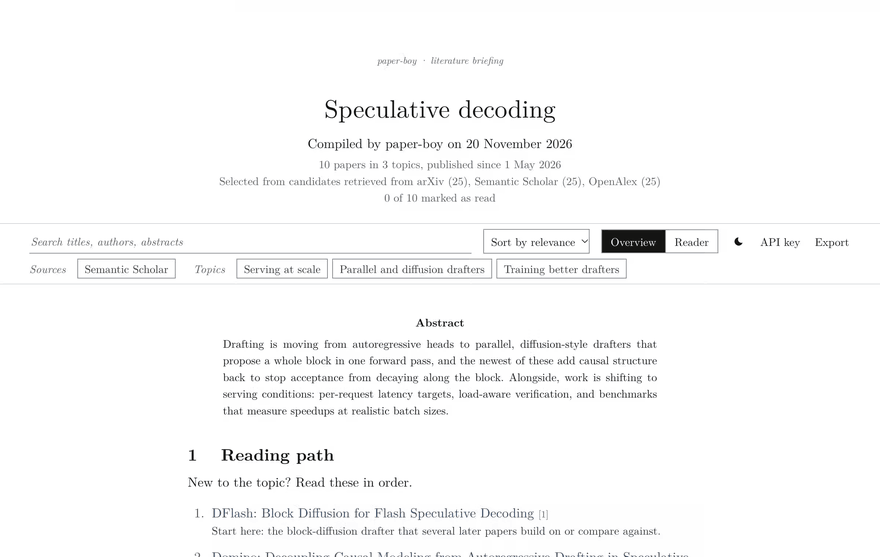

<p align="center">
  <picture>
    <source media="(prefers-color-scheme: dark)" srcset="docs/assets/hero-dark.svg">
    
  </picture>
</p>

<p align="center">
  <a href="https://github.com/jimbo111/paper-boy/tags"></a>
  
  
  <a href="LICENSE"></a>
</p>

<p align="center">
  Give it a topic. It finds the papers published on it in the last few months,<br>
  reads their abstracts, sorts them into themes, picks where to start,<br>
  and hands you <b>one HTML file</b> that reads like a journal article and works offline.
</p>

<p align="center">
  <a href="#quick-start">Quick start</a> ·
  <a href="#what-you-get">What you get</a> ·
  <a href="#how-it-works">How it works</a> ·
  <a href="#standalone-usage">Standalone CLI</a> ·
  <a href="#using-the-reader">Using the reader</a>
</p>

<p align="center">
  
  <br>
  <sub>A real run on <i>speculative decoding</i>: 10 of 34 retrieved papers, each summary written from that paper's own abstract.</sub>
</p>

## Quick start

paper-boy is a Claude Code plugin. Its repo is its own marketplace, so there is nothing to clone:

```
/plugin marketplace add jimbo111/paper-boy
/plugin install paper-boy@paper-boy-marketplace
```

Then ask for a topic:

```
/paper-boy speculative decoding
/paper-boy protein structure prediction --since 2026-01-01 --max 30
```

The finished page opens in your browser and is saved under `~/paper-boy/<topic>/<date>/`. No API key is needed in this mode; the Claude Code session does the reading. To run it without Claude Code, see [Standalone usage](#standalone-usage).

| Flag | What it does | Default |
|---|---|---|
| `--since YYYY-MM-DD` | earliest publication date | 18 months ago |
| `--max N` | how many papers to keep | 40 |
| `--deep N` | how many top papers get a full-text read | 5 |
| `--field X` | an extra term to narrow the search, such as `cs.CV` | none |
| `--no-open` | don't open the page when done | opens |

## What you get

**Real papers only.** Every title, author, date, link and citation count comes from an arXiv, Semantic Scholar or OpenAlex response. The model only annotates papers the search actually returned, and only from their abstracts or full text. Nothing is invented; a paper with no abstract gets a minimal note rather than a guess.

**A way in.** A short reading path, foundational first, with a line on why each paper comes at that point. Then the papers grouped into themes, each with a one-line synthesis of what the group shows.

**A page that reads like a paper.** Title block, abstract, numbered sections and a numbered bibliography, set in Latin Modern (the LaTeX typeface). A two-pane reader for going paper by paper with `j` and `k`. Light and dark, and it prints cleanly.

**One file.** Fonts and data are inlined into a single `index.html`, a few hundred KB for a typical run. It makes no network requests except the links to the papers themselves, so you can archive it, email it, or open it on a plane.

**Exports.** BibTeX, RIS (Zotero, Mendeley, EndNote), a Markdown report and the full JSON, all generated in the browser from the page itself.

## How it works

<p align="center">
  <picture>
    <source media="(prefers-color-scheme: dark)" srcset="docs/assets/pipeline-dark.svg">
    
  </picture>
</p>

1. **fetch** (`bin/fetch.mjs`) queries arXiv, Semantic Scholar and OpenAlex in parallel, dedupes by DOI, arXiv id and normalized title, and writes `papers.raw.json`. Deterministic; no model involved.
2. **enrich** (`bin/enrich.mjs`) adds per-paper summaries, relevance scores, themes, a reading path for newcomers, and full-text deep-dives, and writes `papers.enriched.json`. Inside Claude Code the session does this step; standalone, it calls the provider you choose.
3. **render** (`bin/render.mjs`) turns the enriched JSON into the single `index.html`.

Each stage is a small Node script with **zero npm dependencies**, so you can run, inspect or replace any of them on its own.

## The one rule: no fabrication

Papers are fetched, never invented. Every title, link, date, author, and citation count
comes from a real source response. The LLM only annotates papers that the fetch step
actually returned, grounded strictly in their real abstracts (and full text, when a
deep-dive can retrieve it). Theme and reading-path entries that don't point at a real,
kept paper are dropped. This is the entire value of the tool.

## Requirements

- Node.js 18 or later (uses the built-in test runner and `fetch`; **zero npm dependencies**).
- Inside Claude Code: nothing else.
- Standalone: an API key for one of the supported providers.

To work on the code itself:

```bash
git clone https://github.com/jimbo111/paper-boy.git
cd paper-boy
npm test   # 138 tests, offline except one network smoke test
```

To try local changes in Claude Code, point the marketplace at your checkout:
`/plugin marketplace add /path/to/paper-boy`.

## Standalone usage

```bash
# 1. fetch real papers
node bin/fetch.mjs --query "vision language model fine-tuning" --since 2024-12-01 --out run/papers.raw.json

# 2. enrich with your own model
export ANTHROPIC_API_KEY=sk-...
node bin/enrich.mjs --in run/papers.raw.json --out run/papers.enriched.json

# 3. render the reader
node bin/render.mjs --in run/papers.enriched.json
```

### Providers and keys

| Provider | `--provider` | API key env var | Default model |
|----------|--------------|-----------------|---------------|
| Anthropic (Claude) | `anthropic` | `ANTHROPIC_API_KEY` | `claude-opus-5` |
| OpenAI (GPT) | `openai` | `OPENAI_API_KEY` | `gpt-4o` |
| DeepSeek | `deepseek` | `DEEPSEEK_API_KEY` | `deepseek-chat` |
| OpenAI-compatible / local | `openai-compat` | `PAPER_BOY_API_KEY` | (pass `--model`) |

The `openai-compat` provider points at any OpenAI-compatible `--base-url`, which covers
Groq, Together, Ollama, vLLM, and Gemini's compatibility endpoint:

```bash
node bin/enrich.mjs --in run/papers.raw.json \
  --provider openai-compat --base-url http://localhost:11434/v1 --model llama3.1
```

### Configuration

Settings resolve with the precedence **flag > environment variable > config file > default**.

Flags: `--provider`, `--model`, `--api-key`, `--base-url`, `--deep N`, `--concurrency N`,
`--rps N`, `--config <path>`.

Environment variables: `PAPER_BOY_PROVIDER`, `PAPER_BOY_MODEL`, `PAPER_BOY_BASE_URL`,
`PAPER_BOY_API_KEY` (and the provider-specific key vars above), `PAPER_BOY_CONCURRENCY`,
`PAPER_BOY_RPS`, `PAPER_BOY_DEEP`, `PAPER_BOY_CONFIG`.

Optional config file at `~/.config/paper-boy/config.json` (override the path with
`PAPER_BOY_CONFIG`):

```json
{
  "provider": "anthropic",
  "model": "claude-opus-5",
  "apiKey": "sk-...",
  "maxConcurrency": 4,
  "rps": 2,
  "deep": 5
}
```

API keys are never logged. A malformed config file is ignored with a warning rather than
aborting the run. Individual model-call failures are logged and tolerated, but if **every**
call fails (revoked key, wrong model name), enrich exits non-zero rather than writing
placeholder output. Keep any local `config.json` or `.env` out of version control (both are
gitignored).

### Data-source keys (optional)

`fetch` works with no keys at all. To raise rate limits, set `S2_API_KEY` for Semantic
Scholar and `PAPER_BOY_MAILTO` (your email) to join OpenAlex's faster "polite pool".
Neither is required and neither is ever hardcoded.

## Deep-dives and the full-text limitation

For the top `--deep N` must-read papers, enrich tries to retrieve full text and extract
structured findings, method, and limitations. The retrieval ladder is dependency-free:

1. ar5iv HTML render (`ar5iv.org/abs/<id>`)
2. arXiv native HTML (`arxiv.org/html/<id>`)
3. abstract-only fallback (clearly flagged; the model is told it only has the abstract
   and must not invent method details)

Reliable PDF text extraction with zero dependencies is not feasible, so paper-boy does
**not** parse PDFs by default. If a `pdftotext` binary is on your `PATH` you can wire it
in as an optional escape hatch, but the default path relies on HTML renders. A failed
deep-dive never aborts the run — that paper simply keeps its abstract-level summary.

## Related work (optional)

Pass `--related N` to enrich to expand each must-read paper's **most-cited references**
via the OpenAlex citation graph. This is deterministic (no API key required) and off by
default:

```bash
node bin/enrich.mjs --in run/papers.raw.json --related 5
```

Each must-read then carries a `related[]` list (title, authors, year, citations, link),
shown in the reader under the paper and never fabricated — an unreachable reference list
simply yields an empty result.

## Using the reader

`index.html` opens in any browser, offline, with no install. It is typeset like a journal
article (Latin Modern, the LaTeX typeface) rather than a search-results page, so you can
enter a field you don't know yet:

- **Overview** — a title block, the cross-paper trend as the abstract, then numbered
  sections: the reading path first, then one section per theme with a one-line synthesis
  and its papers as a numbered bibliography. A paper keeps its `[n]` everywhere.
- **Reading path** — a short ordered on-ramp (up to five papers), foundational first, each
  with one line on why to read it at that point. Start here if the topic is new to you.
- **Reader** — a two-pane view: paper list on the left, the full write-up on the right
  (TL;DR, summary, what's new, why it matters, abstract, related work, and — where a
  full-text deep-dive succeeded — its findings, method, and limitations).
- **Search and filter** — free-text search plus source and topic filters; `/` focuses the
  search box from anywhere and `Esc` clears it (menus close first if one is open).
- **Keyboard** — in Reader view, `j` / `k` (or `↑` / `↓`) move through papers and `⏎` opens
  the current one at its source. **Prev** / **Next** buttons step through them by mouse or
  touch.
- **Read tracking** — mark papers read; progress is kept per topic in your browser, so
  you can pick a long run back up later.
- **Light and dark** — defaults to your system theme, toggleable, and remembers your
  choice from then on. Printing always uses the light version.

## Exports

The reader's **Export** menu downloads everything client-side, with nothing written to a
server: the Markdown report, the enriched JSON, a **BibTeX** library, and an **RIS** file
for direct import into Zotero, Mendeley, or EndNote.

## Analyzing abstracts in the reader (bring your own key)

Every report ships with full summaries already written — no key needed to read it. If you
want to dig further into a specific paper, the reader has an **API key** panel: paste your
own Anthropic or OpenAI key and an **Analyze abstract** button on each paper produces a live
structured analysis (findings, method, limitations, significance).

- The key is sent **directly from the page to the provider you choose** and is never
  written into any download. Choose **session-only** (held until you close the tab) or
  **remember on this device** (stored in the browser's local storage).
- In-browser analysis is **abstract-based** — browsers can't fetch paper full text
  (CORS), so for full-text deep-dives use the standalone `enrich` CLI.
- Only Anthropic and OpenAI are offered here, because most other endpoints block
  direct browser calls.

## Output

Runs land in `~/paper-boy/<slug>/<date>/`:

- `index.html` — the self-contained reader (open it in any browser)
- `papers.raw.json` — the deduped fetch result (audit trail)
- `papers.enriched.json` — the curated data the reader is built from

## Development

```bash
npm test            # all tests
npm run test:offline  # skip the one network smoke test
```

Tests use only Node's built-in `node:test`. See `ARCHITECTURE.md` for the module layout
and `CONTRIBUTING.md` for how to add a provider or data source.

## License

MIT — see `LICENSE`. The bundled typeface is a renamed Latin subset of Latin Modern Roman,
distributed under the GUST Font License (`template/fonts/README-fonts.txt`,
`template/fonts/GUST-FONT-LICENSE.txt`).
